# 新生宿舍管理系统

> 🎓 **计算机毕业设计 · 新生宿舍管理系统**
>
> 本仓库只放**项目介绍 + 运行截图**（截图是站点带水印的原图，存在仓库 `images/` 里）。
>
> 👉 **完整可运行源码 / 数据库脚本 / 部署文档：[点我获取](https://geekcode.top/archives/%E6%96%B0%E7%94%9F%E5%AE%BF%E8%88%8D%E7%AE%A1%E7%90%86%E7%B3%BB%E7%BB%9F?utm_source=github)**
>
> 💬 咨询微信：**ir9372**　|　🌐 更多项目：[极客代码 geekcode.top](https://geekcode.top/?utm_source=github)
>
> 📌 项目详情页：<https://geekcode.top/archives/%E6%96%B0%E7%94%9F%E5%AE%BF%E8%88%8D%E7%AE%A1%E7%90%86%E7%B3%BB%E7%BB%9F?utm_source=github>

<table><td width="230" align="center"> <b>扫码加微信 ir9372</b></td><td valign="middle">📦 源码 = 项目介绍 + 全部运行截图 + 数据库 + 部署文档 👉 点上方任意截图，直接跳到 <b>极客代码 geekcode.top</b> 详情页</td></table>

---

<h1>新生宿舍管理系统</h1>
<h2>项目概述</h2>

新生宿舍管理系统旨在解决高校宿舍资源分配、日常管理及维护过程中的效率低下与信息不对称问题。系统基于 Spring Boot 与 Vue 技术栈构建，采用前后端分离架构，主要服务于学校后勤管理部门及宿管中心。核心功能涵盖学生信息管理、院系班级配置、宿舍资源录入、住宿安排、卫生检查记录、报修申请及处理流程、以及缴费信息管理等模块。通过数字化手段实现宿舍全生命周期的闭环管理，提升管理透明度与响应速度，适用于各类高等院校的宿舍行政管理场景。

<h2>技术架构</h2>

本项目采用经典的前后端分离架构设计，确保系统的可扩展性与维护性。

<strong>1. 后端架构</strong>
后端基于 Java 语言开发，使用 Spring Boot 作为核心框架，利用其自动配置特性简化开发流程。数据持久层选用 MyBatis-Plus，在保留 MyBatis 灵活性的基础上提供通用的 CRUD 操作封装，显著提升数据库交互效率。安全认证与授权模块集成 Apache Shiro，实现细粒度的权限控制与会话管理。通信协议遵循 RESTful API 规范，通过 <code>spring-boot-starter-web</code> 提供 HTTP 服务接口。

<strong>2. 前端架构</strong>
前端采用 Vue.js 框架构建单页应用（SPA），结合 Element UI 等组件库实现后台管理界面的快速搭建。前端通过 Axios 异步请求与后端进行数据交互，负责视图渲染与用户交互逻辑，实现了界面与数据的解耦。

<strong>3. 数据库设计要点</strong>
底层数据存储使用 MySQL 关系型数据库。根据控制器列表推导，数据库核心表结构应包含：用户表（<code>user</code>）、院系表（<code>yuanxi</code>）、班级表（<code>banji</code>）、学生信息表（<code>xuesheng</code>）、宿舍信息表（<code>sushexinxi</code>）、宿舍安排关联表（<code>susheanpai</code>）、报修信息表（<code>baoxiuxinxi</code>）、报修处理记录表（<code>baoxiuchuli</code>）、卫生检查表（<code>weishengjiancha</code>）、缴费信息表（<code>jiaofeixinxi</code>）及公告信息表（<code>gonggaoxinxi</code>）。各表之间通过外键或业务 ID 建立关联，确保数据一致性。

<a href="https://geekcode.top/archives/%E6%96%B0%E7%94%9F%E5%AE%BF%E8%88%8D%E7%AE%A1%E7%90%86%E7%B3%BB%E7%BB%9F?utm_source=github" title="查看完整源码">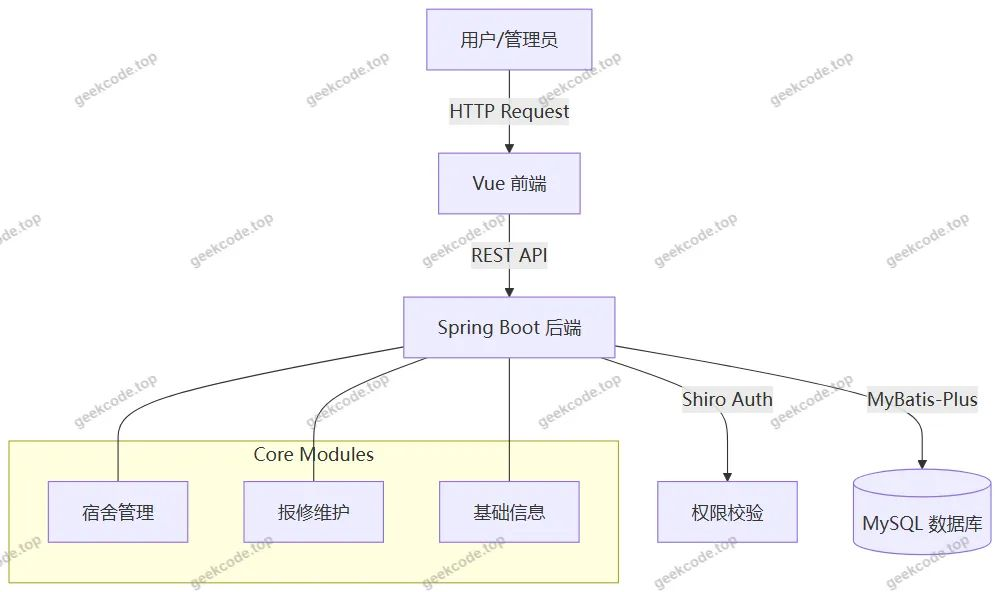</a>

<h2>功能模块</h2>

本系统仅包含后台管理端，无前台用户端页面。所有功能均通过后台路由 <code>/baoxiuxinxi</code>, <code>/yuanxi</code>, <code>/jiaofeixinxi</code>, <code>/xuesheng</code>, <code>/sushexinxi</code>, <code>/susheanpai</code>, <code>/weishengjiancha</code>, <code>/baoxiuchuli</code>, <code>/gonggaoxinxi</code>, <code>/banji</code> 进行访问和管理。

<strong>1. 基础信息管理模块</strong>

<ul>
<li><strong>院系管理 (<code>/yuanxi</code>)</strong>：负责学校院系的增删改查，作为学生归属的一级组织单位。</li>
<li><strong>班级管理 (<code>/banji</code>)</strong>：管理各院系下的具体班级信息，建立学生与班级的关联。</li>
<li><strong>学生管理 (<code>/xuesheng</code>)</strong>：录入和维护学生的基本信息，包括姓名、学号、所属院系及班级等。</li>
<li><strong>公告信息管理 (<code>/gonggaoxinxi</code>)</strong>：发布和管理宿舍相关的通知、规章制度等公共信息。</li>
</ul>

<strong>2. 宿舍资源与分配模块</strong>

<ul>
<li><strong>宿舍信息管理 (<code>/sushexinxi</code>)</strong>：定义宿舍楼栋、房间号、床位数量、设施状态等静态资源数据。</li>
<li><strong>宿舍安排管理 (<code>/susheanpai</code>)</strong>：执行具体的住宿分配逻辑，将学生信息与宿舍床位进行绑定，支持调宿等操作。</li>
</ul>

<strong>3. 运维与服务模块</strong>

<ul>
<li><strong>报修信息管理 (<code>/baoxiuxinxi</code>)</strong>：记录宿舍设施损坏情况，包括报修人、故障描述、图片凭证及报修时间。</li>
<li><strong>报修处理管理 (<code>/baoxiuchuli</code>)</strong>：针对已提交的报修单进行派工、维修进度更新及完工确认，形成处理闭环。</li>
<li><strong>卫生检查管理 (<code>/weishengjiancha</code>)</strong>：记录对各宿舍的定期卫生检查结果，包括评分、存在问题及整改建议。</li>
<li><strong>缴费信息管理 (<code>/jiaofeixinxi</code>)</strong>：管理学生宿舍费用的缴纳记录，包括费用类型、金额、支付状态及时间。</li>
</ul>

<strong>4. 系统支撑模块</strong>

<ul>
<li><strong>通用接口 (<code>CommonController</code>)</strong>：提供字典数据获取、验证码生成等公共辅助功能。</li>
<li><strong>文件管理 (<code>FileController</code>)</strong>：处理用户上传的图片、文档等非结构化数据。</li>
<li><strong>配置管理 (<code>ConfigController</code>)</strong>：管理系统参数配置。</li>
</ul>
<h2>用户角色与权限</h2>

根据截图显示“后台-登录页 (admin)”及各模块均为 admin 视角，且技术选型中使用了 Shiro 框架，系统主要面向管理员角色。虽然代码中存在 <code>UserController</code>，但在提供的路由和截图中未体现普通学生或教师的独立登录入口或差异化视图。因此，基于现有信息，系统主要权限模型如下：

<strong>管理员 (Admin)</strong>
拥有系统最高权限，可访问所有后台路由模块。具体权限覆盖：

<ul>
<li><strong>全量数据管理</strong>：对院系、班级、学生、宿舍信息进行完整的 CRUD（增删改查）操作。</li>
<li><strong>业务流程控制</strong>：审批和执行宿舍安排，处理报修工单的状态流转，录入卫生检查结果。</li>
<li><strong>信息发布与维护</strong>：编辑和发布宿舍公告，管理缴费信息的录入与核对。</li>
<li><strong>系统配置</strong>：修改系统基础配置，管理上传的文件资源。</li>
</ul>

<em>(注：根据现有上下文，无法确定是否存在受限的学生或教师角色及其具体权限范围，所有可见功能均由管理员账户操作。)</em>

<h2>项目特色与创新点</h2>

<strong>1. 宿舍全生命周期闭环管理</strong>
系统不仅关注静态的宿舍资源分配，还深度整合了动态的运维过程。从“宿舍安排”到“卫生检查”，再到“报修申请”与“报修处理”，形成了完整的管理链条。特别是将报修分为“信息提交”与“处理反馈”两个独立模块，明确了责任分工，提升了故障响应效率。

<strong>2. 多维度的数据关联与统计基础</strong>
通过将学生、班级、院系三级组织架构与宿舍物理空间（楼栋、房间）进行关联，系统为后续的统计分析提供了坚实的数据基础。例如，可以方便地查询某院系的新生入住率、某楼栋的平均报修频次或卫生达标率，为后勤决策提供数据支持。

<strong>3. 轻量级高可用的技术选型</strong>
采用 Spring Boot + MyBatis-Plus + Shiro 的组合，既保证了企业级应用的安全性（Shiro 权限控制）和稳定性，又通过 MyBatis-Plus 减少了大量重复的 SQL 编写工作，降低了开发和维护成本。前后端分离架构使得界面交互更加流畅，同时便于后续扩展移动端或其他客户端接入。

<h2>部署环境</h2>

为确保新生宿舍管理系统的正常运行，需准备以下软件及硬件环境：

<strong>1. 服务端环境</strong>

<ul>
<li><strong>操作系统</strong>：Windows Server / Linux (CentOS/Ubuntu)</li>
<li><strong>JDK 版本</strong>：Java Development Kit 1.8 或以上</li>
<li><strong>Web 容器</strong>：内置 Tomcat (由 Spring Boot Starter Web 提供)</li>
<li><strong>数据库</strong>：MySQL 5.7 或 MySQL 8.0</li>
<li><strong>构建工具</strong>：Maven 3.x</li>
</ul>

<strong>2. 前端运行环境</strong>

<ul>
<li><strong>Node.js</strong>：LTS 版本 (建议 v14+)</li>
<li><strong>包管理器</strong>：npm 或 yarn</li>
<li><strong>浏览器</strong>：Chrome, Firefox, Edge 等现代浏览器</li>
</ul>

<strong>3. 关键配置文件依赖</strong>

<ul>
<li><code>application.yml</code> 或 <code>application.properties</code>：用于配置数据库连接 URL、用户名密码、Shiro 密钥、文件上传路径等。</li>
<li><code>pom.xml</code>：包含 spring-boot-starter-web, mybatis-plus, shiro-spring, mysql-connector-java 等依赖声明。</li>
</ul>

<strong>4. 启动步骤简述</strong>

<ol>
<li>导入 SQL 脚本至 MySQL 数据库，创建所需的表结构（如 <code>user</code>, <code>yuanxi</code>, <code>sushexinxi</code> 等）。</li>
<li>配置后端项目的数据库连接信息。</li>
<li>使用 Maven 命令打包后端 jar 包并运行。</li>
<li>进入前端项目目录，安装依赖并编译打包，将生成的静态资源部署至 Nginx 或直接由后端托管（视具体集成方式而定）。</li>
</ol>
<h2>五、技术特性</h2>
<ul>
<li>前后端集成部署，前端资源打包至后端 static 目录</li>
<li>使用 MyBatis-Plus 简化数据访问层开发</li>
<li>集成 Shiro 权限框架实现角色权限控制</li>
</ul>
<h2>六、功能模块截图</h2>
<h3>后台管理端</h3>
<h4>后台-班级</h4>

<a href="https://geekcode.top/archives/%E6%96%B0%E7%94%9F%E5%AE%BF%E8%88%8D%E7%AE%A1%E7%90%86%E7%B3%BB%E7%BB%9F?utm_source=github" title="查看完整源码">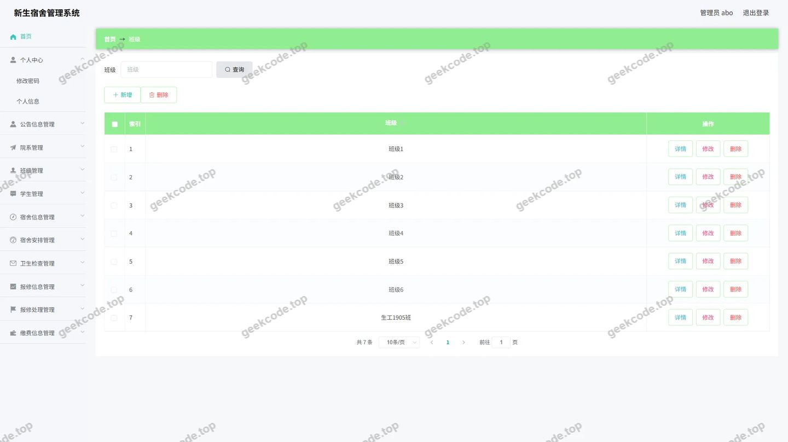</a>

<h4>后台-报修处理</h4>

<a href="https://geekcode.top/archives/%E6%96%B0%E7%94%9F%E5%AE%BF%E8%88%8D%E7%AE%A1%E7%90%86%E7%B3%BB%E7%BB%9F?utm_source=github" title="查看完整源码">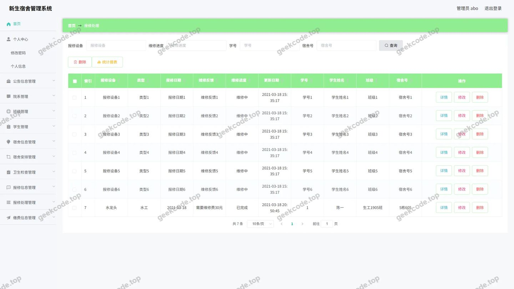</a>

<h4>后台-报修信息</h4>

<a href="https://geekcode.top/archives/%E6%96%B0%E7%94%9F%E5%AE%BF%E8%88%8D%E7%AE%A1%E7%90%86%E7%B3%BB%E7%BB%9F?utm_source=github" title="查看完整源码">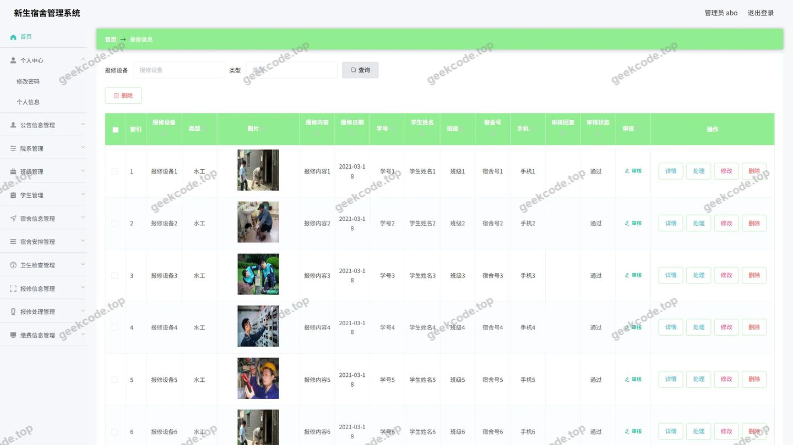</a>

<h4>后台-公告信息</h4>

<a href="https://geekcode.top/archives/%E6%96%B0%E7%94%9F%E5%AE%BF%E8%88%8D%E7%AE%A1%E7%90%86%E7%B3%BB%E7%BB%9F?utm_source=github" title="查看完整源码">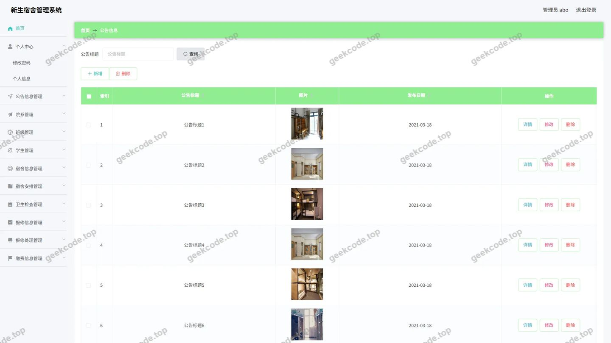</a>

<h4>后台首页</h4>

<a href="https://geekcode.top/archives/%E6%96%B0%E7%94%9F%E5%AE%BF%E8%88%8D%E7%AE%A1%E7%90%86%E7%B3%BB%E7%BB%9F?utm_source=github" title="查看完整源码">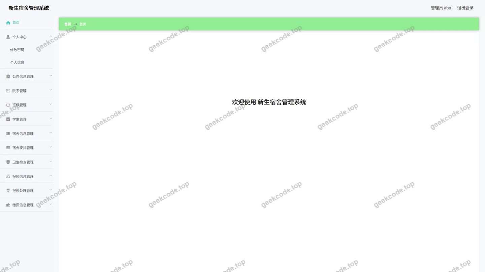</a>

<h4>后台-缴费信息</h4>

<a href="https://geekcode.top/archives/%E6%96%B0%E7%94%9F%E5%AE%BF%E8%88%8D%E7%AE%A1%E7%90%86%E7%B3%BB%E7%BB%9F?utm_source=github" title="查看完整源码">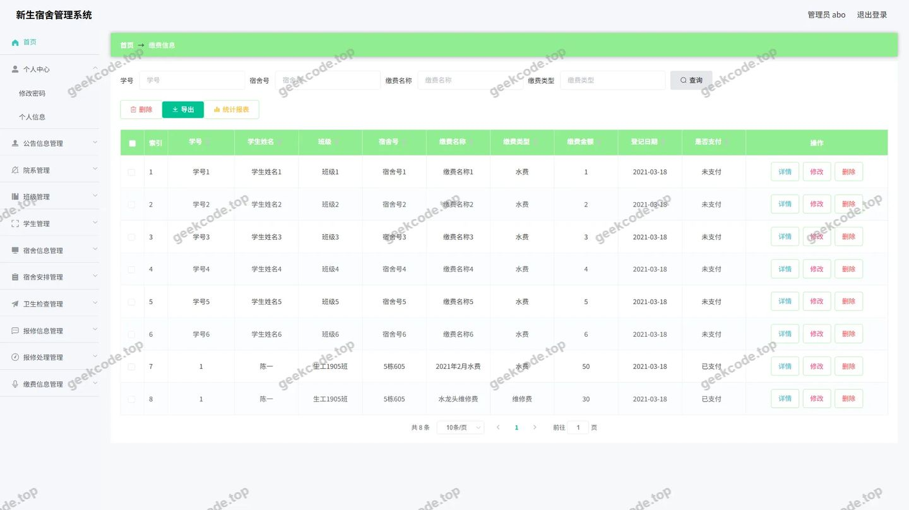</a>

<h4>后台-登录</h4>

<h4>后台-宿舍安排</h4>

<a href="https://geekcode.top/archives/%E6%96%B0%E7%94%9F%E5%AE%BF%E8%88%8D%E7%AE%A1%E7%90%86%E7%B3%BB%E7%BB%9F?utm_source=github" title="查看完整源码">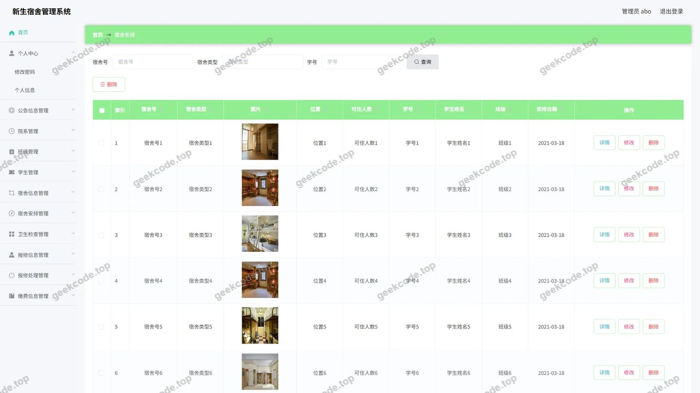</a>

<h4>后台-宿舍信息</h4>

<a href="https://geekcode.top/archives/%E6%96%B0%E7%94%9F%E5%AE%BF%E8%88%8D%E7%AE%A1%E7%90%86%E7%B3%BB%E7%BB%9F?utm_source=github" title="查看完整源码">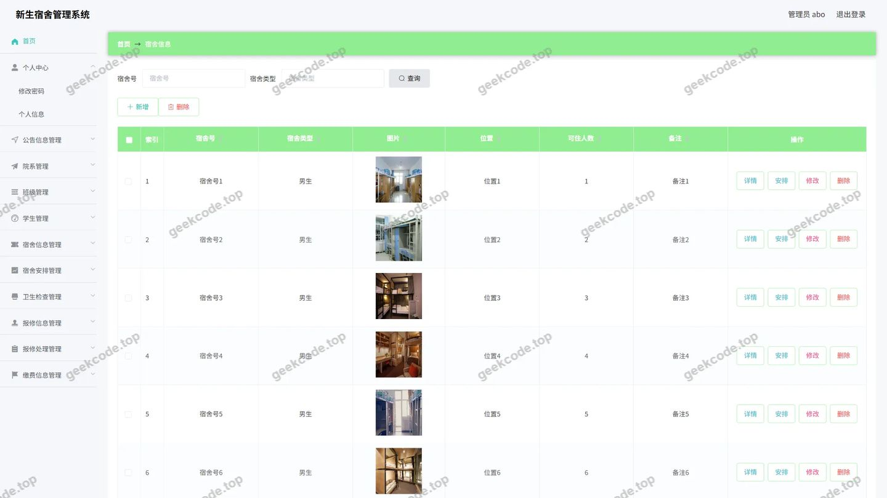</a>

<h4>后台-卫生检查</h4>

<a href="https://geekcode.top/archives/%E6%96%B0%E7%94%9F%E5%AE%BF%E8%88%8D%E7%AE%A1%E7%90%86%E7%B3%BB%E7%BB%9F?utm_source=github" title="查看完整源码">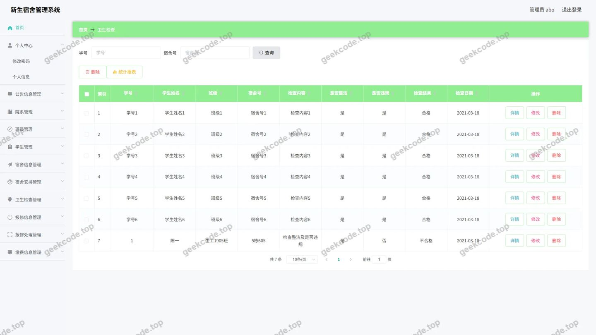</a>

<h4>后台-学生</h4>

<a href="https://geekcode.top/archives/%E6%96%B0%E7%94%9F%E5%AE%BF%E8%88%8D%E7%AE%A1%E7%90%86%E7%B3%BB%E7%BB%9F?utm_source=github" title="查看完整源码">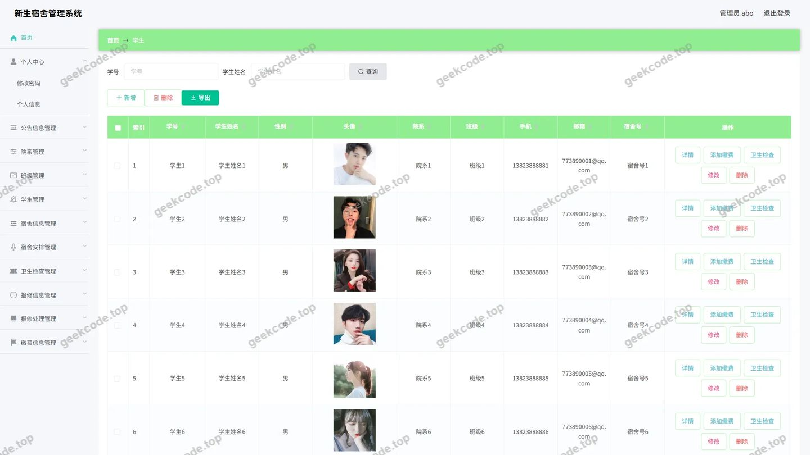</a>

<h4>后台-院系</h4>

---

## 获取完整源码

| 项目 | 说明 |
| --- | --- |
| 项目名 | 新生宿舍管理系统 |
| 运行截图 | 本文 13 张（站点带水印原图，仓库 `images/` 目录） |
| 完整源码 | [https://geekcode.top/archives/%E6%96%B0%E7%94%9F%E5%AE%BF%E8%88%8D%E7%AE%A1%E7%90%86%E7%B3%BB%E7%BB%9F?utm_source=github](https://geekcode.top/archives/%E6%96%B0%E7%94%9F%E5%AE%BF%E8%88%8D%E7%AE%A1%E7%90%86%E7%B3%BB%E7%BB%9F?utm_source=github) |
| 咨询微信 | **ir9372**（备注：jingpin-yuanma） |
| 更多项目 | [极客代码 geekcode.top](https://geekcode.top/?utm_source=github) |

> 需要源码、部署、改配置、跑不起来等问题，加微信 ir9372 沟通，说明项目名即可。
